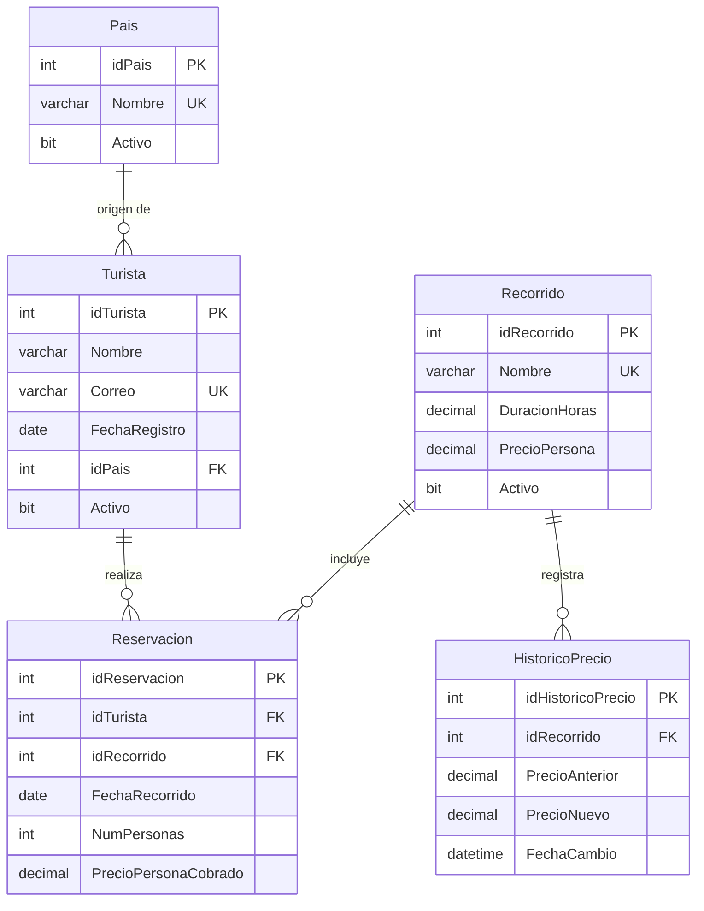

# RecorreMTYDB

Base de datos relacional para administrar las reservaciones de **RecorreMTY**, un servicio de recorridos turísticos guiados por Monterrey.

## Descripción

Los turistas se registran una sola vez y se identifican por su correo electrónico. Cada reservación conserva el precio por persona vigente al momento de hacerla, por lo que las actualizaciones posteriores del precio no alteran lo que ya se cobró. Los turistas y recorridos se dan de baja mediante baja lógica para mantener el historial.

La base de datos administra países de origen, recorridos, turistas, reservaciones y el histórico de cambios de precio. Aplica las reglas del negocio mediante llaves, restricciones, procedimientos, funciones, vistas y un trigger.

## Modelo relacional

## Reglas y decisiones de diseño

### Pais

- Catálogo de países de origen; no depende de otra tabla.
- `idPais` es la llave primaria y `Nombre` es único.
- `Activo` tiene `DEFAULT 1`. Dar de baja un país cambia este valor a `0`, sin borrar el registro.

### Recorrido

- Catálogo de recorridos con el precio por persona vigente.
- `idRecorrido` es la llave primaria y `Nombre` es único.
- `DuracionHoras` y `PrecioPersona` deben ser mayores que cero; `Activo` tiene `DEFAULT 1`.
- Los cambios de precio se guardan en `HistoricoPrecio`. Las reservaciones conservan una copia del precio cobrado.

### Turista

- Cada turista tiene un país de origen mediante la llave foránea `idPais`.
- `idTurista` es la llave primaria; `Correo` es único incluso para turistas dados de baja, porque identifica al turista.
- `FechaRegistro` es obligatoria. `Activo` tiene `DEFAULT 1`.
- La baja es lógica: se cambia `Activo` a `0` para conservar las reservaciones.

### Reservacion

- Tabla de hechos: registra turista, recorrido, fecha, cantidad de personas y precio cobrado por persona.
- Tiene llaves foráneas a `Turista` y `Recorrido`.
- `NumPersonas` debe estar entre 1 y 10. La restricción `CHECK` protege este límite.
- `PrecioPersonaCobrado` se copia del precio vigente al reservar y no cambia después.
- El total cobrado se calcula como `PrecioPersonaCobrado * NumPersonas`; no se almacena como dato duplicado.
- No tiene columna `Activo`: las reservaciones no se dan de baja.

### HistoricoPrecio

- Registra el recorrido, el precio anterior, el precio nuevo y la fecha y hora de cada cambio.
- Tiene llave foránea a `Recorrido`; todas sus columnas son `NOT NULL` y `FechaCambio` tiene `DEFAULT GETDATE()`.
- El trigger `trg_registrarHistoricoPrecio` registra automáticamente los cambios. No se modifican ni borran filas del histórico.

## Instalación

Ejecuta los scripts en este orden. Selecciona `RecorreMTYDB` cuando el script lo requiera.

| Orden | Script | Descripción |
|---:|---|---|
| 1 | `01-create-database.sql` | Crea la base de datos `RecorreMTYDB`. |
| 2 | `02-create-table-pais.sql` | Crea `Pais`. |
| 3 | `03-create-table-recorrido.sql` | Crea `Recorrido`. |
| 4 | `04-create-table-turista.sql` | Crea `Turista`. |
| 5 | `05-create-table-reservacion.sql` | Crea `Reservacion`. |
| 6 | `06-create-table-historico-precio.sql` | Crea `HistoricoPrecio`. |
| 7 | `07-insert-pais.sql` | Inserta cinco países de origen. |
| 8 | `08-insert-recorrido.sql` | Inserta seis recorridos con su precio vigente. |
| 9 | `09-insert-turista.sql` | Inserta 12 turistas de los cinco países; uno está dado de baja. |
| 10 | `10-insert-reservacion.sql` | Inserta 23 reservaciones con el precio cobrado en cada una. |
| 11 | `11-usp-insertar-turista.sql` | Crea `usp_insertarTurista`. |
| 12 | `12-usp-dar-de-baja-turista.sql` | Crea `usp_darDeBajaTurista`. |
| 13 | `13-usp-insertar-recorrido.sql` | Crea `usp_insertarRecorrido`. |
| 14 | `14-usp-actualizar-precio-recorrido.sql` | Crea `usp_actualizarPrecioRecorrido`. |
| 15 | `15-usp-registrar-reservacion.sql` | Crea `usp_registrarReservacion`. |
| 16 | `16-usp-obtener-reservaciones-por-fecha.sql` | Crea `usp_obtenerReservacionesPorFecha`. |
| 17 | `17-ufn-total-cobrado-recorrido.sql` | Crea `ufn_totalCobradoRecorrido`. |
| 18 | `18-ufn-nivel-turista.sql` | Crea `ufn_nivelTurista`. |
| 19 | `19-vw-detalle-reservacion.sql` | Crea `vw_DetalleReservacion`. |
| 20 | `20-vw-resumen-recorrido.sql` | Crea `vw_ResumenRecorrido`. |
| 21 | `21-trg-registrar-historico-precio.sql` | Crea `trg_registrarHistoricoPrecio`. |

## Reversa

Ejecuta los scripts en este orden:

| Orden | Script | Descripción |
|---:|---|---|
| 1 | `01-drop-tables.sql` | Elimina `HistoricoPrecio`, `Reservacion`, `Turista`, `Recorrido` y `Pais`, en orden inverso a sus dependencias. |
| 2 | `02-drop-database.sql` | Elimina `RecorreMTYDB` y sus objetos. |

Antes de ejecutar `02-drop-database.sql`, selecciona otra base de datos en SQL Server Management Studio, por ejemplo `master`. SQL Server no puede eliminar una base de datos mientras está en uso.

## Objetos programados

### Procedimientos almacenados

| Objeto | Comportamiento |
|---|---|
| `usp_insertarTurista` | Busca el país por nombre, valida que exista y esté activo, y comprueba que el correo no se haya registrado, incluso si pertenece a un turista dado de baja. Inserta al turista activo. Códigos: país inexistente `000001`, país inactivo `000002`, correo duplicado `000003`, éxito `000000`. |
| `usp_darDeBajaTurista` | Busca al turista por correo y cambia `Activo` a `0`. Códigos: no existe `000001`, ya está dado de baja `000002`. No borra el registro. |
| `usp_insertarRecorrido` | Valida que el nombre no exista, que la duración sea positiva y que el precio sea positivo; después inserta el recorrido activo. Códigos: nombre duplicado `000001`, duración inválida `000002`, precio inválido `000003`, éxito `000000`. |
| `usp_actualizarPrecioRecorrido` | Obtiene el identificador y el precio actual en una consulta, valida existencia, precio nuevo positivo y cambio efectivo, y actualiza `Recorrido`. Códigos: no existe `000001`, precio inválido `000002`, precio sin cambio `000003`, éxito `000000`. El trigger escribe el histórico. |
| `usp_registrarReservacion` | Valida existencia y estado activo del recorrido y del turista, obtiene el precio vigente y crea la reservación. El `CHECK` de la tabla valida de 1 a 10 personas. Ante un error de inserción responde `999999` con `ERROR_NUMBER()` y `ERROR_MESSAGE()`; éxito `000000`. |
| `usp_obtenerReservacionesPorFecha` | Lista las reservaciones de un rango inclusivo (`BETWEEN`), con recorrido y turista, ordenadas por fecha y recorrido. Rechaza una fecha inicial posterior a la final con `000001`. Un rango válido sin resultados devuelve cero filas. |

### Funciones

| Objeto | Comportamiento |
|---|---|
| `ufn_totalCobradoRecorrido` | Devuelve la suma de `PrecioPersonaCobrado * NumPersonas`. Devuelve `NULL` si el recorrido no existe y `0.00` si existe pero no tiene reservaciones. |
| `ufn_nivelTurista` | Cuenta todas las reservaciones asociadas al correo, incluidas las de turistas dados de baja. Devuelve `NULL` si el correo no existe; de otro modo, `Sin reservaciones` (0), `Ocasional` (1 o 2) o `Frecuente` (3 o más). |

### Vistas

| Objeto | Comportamiento |
|---|---|
| `vw_DetalleReservacion` | Muestra cada reservación, el precio cobrado y el precio actual del recorrido; clasifica el cambio como `Subió`, `Bajó` o `Sin cambio`. |
| `vw_ResumenRecorrido` | Muestra una fila por recorrido con cantidad de reservaciones, total cobrado y fecha de la reservación más reciente. Incluye recorridos sin reservaciones, con cantidad y total en cero y última fecha `NULL`. |

### Trigger

`trg_registrarHistoricoPrecio` es un trigger `AFTER UPDATE` sobre `Recorrido`. Compara las tablas virtuales `deleted` e `inserted` y agrega al histórico únicamente los recorridos cuyo precio cambió. Funciona con actualizaciones de varias filas y no registra cambios que solo afecten otras columnas, como `Activo`.
